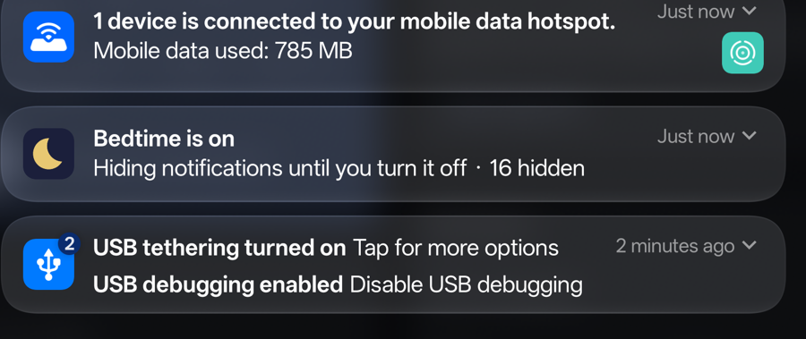
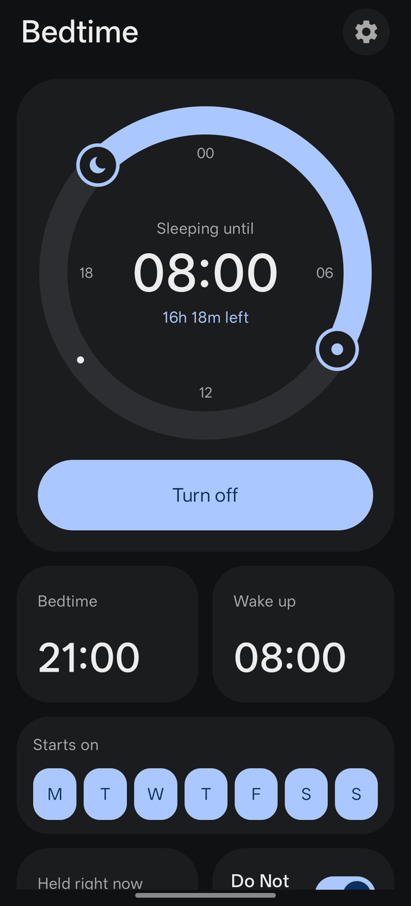
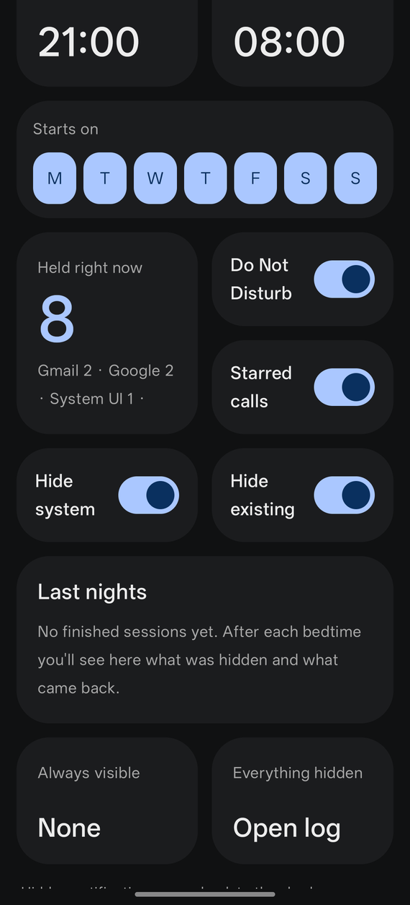
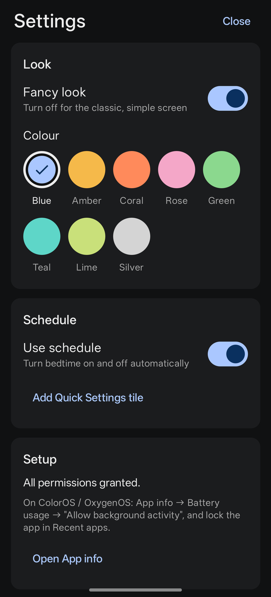
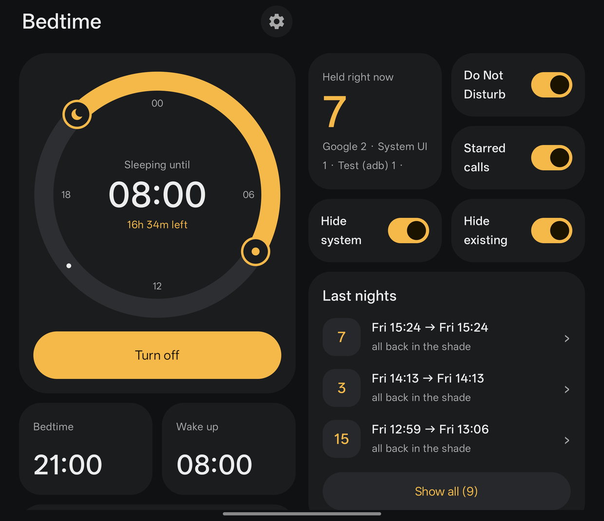
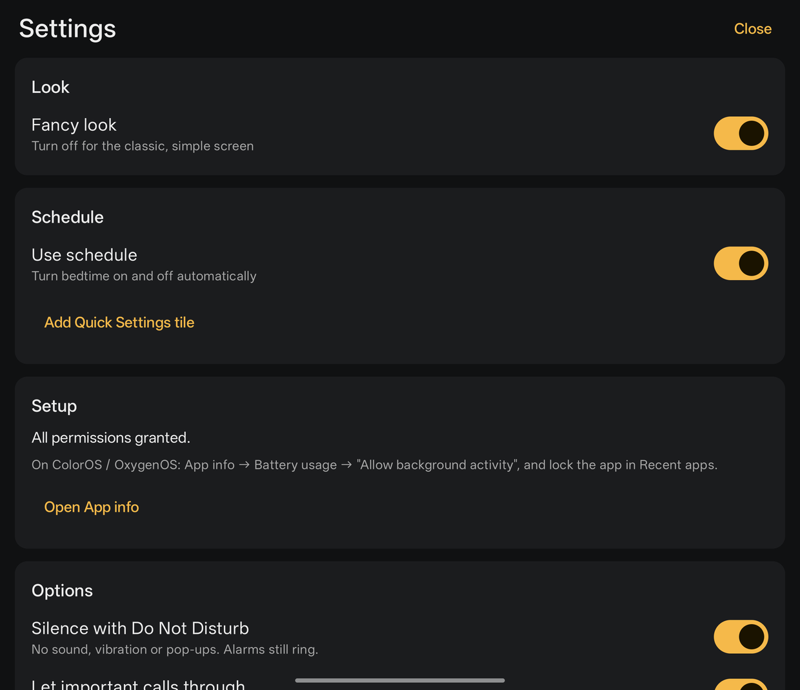
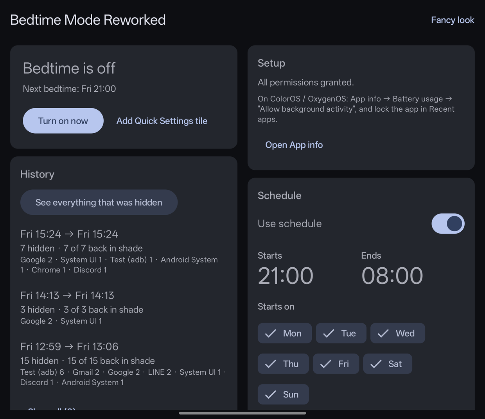
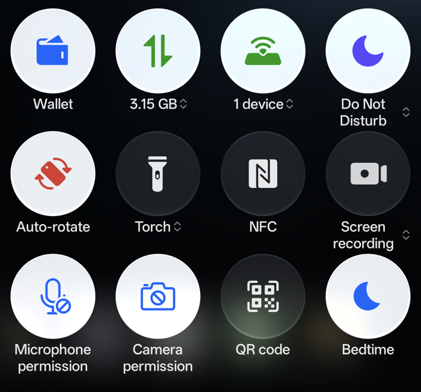

<p align="center">
  
</p>

<h1 align="center">Bedtime Mode Reworked</h1>

<p align="center">
  <b>A bedtime mode that actually works.</b><br>
  Hides every notification at night, keeps your phone silent, and hands everything back in the morning.
</p>

<p align="center">
  <a href="../../releases/latest"><b>⬇ Download the latest APK</b></a>
  &nbsp;·&nbsp; Android 10+ &nbsp;·&nbsp; Free &amp; open source &nbsp;·&nbsp; No ads, no tracking
</p>

<p align="center">
  <a href="../../releases"></a>
  <a href="../../releases/latest"></a>
</p>

---

## Why this exists

I use an OPPO Find N6. On **ColorOS 16**, Bedtime mode was my favourite feature: when it was on,
**nothing** showed up in the notification shade and nothing pushed or buzzed. When the scheduled
bedtime ended, usually in the morning, **every notification came back to the shade**, so I could
calmly review them all at once.

Then I updated to **ColorOS 17** (17.0.0.101 Global). Bedtime mode still exists and can still be
scheduled. But while it's running, notifications **still appear in the shade and still pop up**,
which completely defeats the point. On top of that, the Bedtime toggle was removed from the
quick settings panel.

So I built the app myself: it does what Bedtime mode used to do, and it doesn't depend on the
phone's broken built-in feature.

If your phone's bedtime mode lets notifications through, this is for you. It works on any
Android 10+ phone, not just OPPO.

## What it does

<p align="center">
  
  <br><sub>During bedtime, the shade shows only the app's own "Bedtime is on" notice and ongoing system status.</sub>
</p>

- 🌙 **Hides notifications at night.** Nothing shows in the shade, no banners, no pop-ups.
- 🔕 **Keeps the phone silent.** No sound or vibration. **Alarms still ring.** Optionally let calls
  from starred contacts and repeat callers through.
- ☀️ **Gives everything back.** When bedtime ends (or when you turn it off), every hidden
  notification returns to the shade, untouched, with its buttons and actions still working.
- 🌑 **Black & white screen** (Android 15+). Turns the screen grey during bedtime so it's less
  tempting to scroll. Choose separately for scheduled bedtime and for turning it on by hand. No
  extra permissions; colour comes back when bedtime ends.
- ⏰ **Schedule** with start/end time and the days of the week.
- ⚡ **Quick Settings tile** to turn bedtime on or off anytime, regardless of the schedule.
  Turning it back on resumes tonight's schedule and ends at the usual time.
- 📌 **"Bedtime is on" notice** in the shade while active, with a *Turn off* button.
- 📜 **History**: what was hidden each night, by app, and how much came back. The app also keeps
  its own on-device copy of everything it hid for 7 days, so you can never miss anything.
- ✅ **Allowed apps** that are never hidden, plus an option to hide or show system notifications.
- 🎨 **Two looks.** *Fancy*: a dark screen with a 24-hour dial you drag to set your bedtime,
  everything in big rounded tiles, and 8 accent colours to choose from. *Classic*: simple Material
  cards. Switch any time.
- 🔄 **In-app updates.** The app tells you when a new version is out, shows what changed, and
  updates itself, so you don't need to come back here.

### Fancy look

<p align="center">
  
  &nbsp;
  
  &nbsp;
  
  <br><sub>On a phone (or a foldable's cover screen). Pick from 8 colours: Blue, Amber, Coral, Rose, Green, Teal, Lime, Silver.</sub>
</p>

<p align="center">
  
  <br><sub>Unfolded / tablet / landscape: two columns (shown in Amber). Drag the moon (bedtime) or the dot (wake up) around the dial.</sub>
</p>

<p align="center">
  
  &nbsp;
  
  <br><sub>Settings page (left), with the switch between Fancy and Classic. The Classic look (right).</sub>
</p>

<p align="center">
  
  <br><sub>The Bedtime tile in Quick Settings: one tap to turn it on or off.</sub>
</p>

## Install

1. On your phone, open the **[latest release](../../releases/latest)** and download
   `BedtimeModeReworked-x.y.z.apk`.
2. Open the downloaded file. If asked, allow your browser or file manager to
   **install unknown apps**. *(ColorOS may say "Risk detection failed". Tap **Continue installation**.)*
3. Open **Bedtime RW** and follow the setup. It's one permission per screen, with instructions:

| Step | Why it's needed |
| --- | --- |
| **Notification access** | To hide notifications at night and bring them back. Nothing is read, stored online or sent anywhere. |
| **Do Not Disturb access** | To keep the phone silent. Usually granted automatically with the step above. |
| **Notifications** | For the "Bedtime is on" notice and update alerts. |
| **Unrestricted battery** | So the phone doesn't stop the app in the middle of the night. |
| **Turn off the phone's own Bedtime / DND schedules** | So they don't fight with this app. |
| **Quick Settings tile** | One-tap on/off from the top-right swipe-down panel. |
| **Your bedtime** | Pick when it starts and ends. |

> **"Restricted setting" / switch greyed out?** Android blocks notification access for apps
> installed from a downloaded file. Go to **App info → ⋮ (top-right) → Allow restricted settings**,
> then try again.

> **ColorOS / OxygenOS:** also go to **App info → Battery usage → Allow background activity**,
> and lock the app in Recent apps.

## How it works (for the curious)

- **Hiding:** the app uses Android's built-in **notification snooze** (through notification access).
  Snoozed notifications leave the shade and Android itself puts them back when the snooze ends.
  If you turn bedtime off early, the app ends the snooze right away and everything returns
  within a second.
- **Silence:** the app creates its **own Do Not Disturb rule**, called *Bedtime Mode Reworked* in
  your DND schedules. Keep it enabled. Your other DND settings are never touched.
- **Never hidden:** alarms, calls, ongoing notifications (music, navigation, downloads),
  and any apps you allow.
- **On time, even on aggressive phones:** some phones delay app timers by up to an hour to save
  battery. The app works around this so bedtime starts and ends on the minute.
- **Privacy:** the only network request is checking GitHub Releases for updates. Everything else
  stays on your phone.

## Tested phones

| Phone | OS | Status |
| --- | --- | --- |
| OPPO Find N6 | ColorOS 17 (Android 17) | ✅ Works |
| OPPO Find X9 Ultra | ColorOS | ✅ Works |

Tried it on another phone? [Open an issue](../../issues) with your model and OS version and it'll be added here.

## FAQ

**Will I lose notifications?** No. Hidden notifications are snoozed, not dismissed, and they come
back when bedtime ends. The app also keeps its own 7-day log of everything it hid
(*History → See everything that was hidden*).

**Does it drain the battery?** No. It does nothing until a notification arrives or bedtime starts
or ends.

**Can I still be reached in an emergency?** Alarms always ring. Turn on *Let important calls through*
to allow starred contacts and repeat callers.

**My phone isn't an OPPO. Will it work?** Yes. It only uses standard Android features (Android 10+).

## Troubleshooting

| Problem | Fix |
| --- | --- |
| Notification access switch is greyed out | App info → ⋮ → *Allow restricted settings* |
| Stops working overnight | Allow unrestricted battery / background activity; lock the app in Recents |
| Phone still makes sounds | Check *Silence with Do Not Disturb* is on, and that *Bedtime Mode Reworked* is enabled in DND schedules |
| Two bedtime modes fighting | Turn off the system Bedtime (Digital Wellbeing → Bedtime mode → routine: *None*) |

Found a bug? [Open an issue](../../issues). Include your phone model and Android/OS version.

## Building from source

Requires JDK 17+ and the Android SDK (platform 35).

```bash
./gradlew assembleDebug      # debug build
./gradlew assembleRelease    # release build (needs keystore.properties, see below)
scripts/install.sh           # build + install over adb + pre-grant permissions
```

Release signing reads `keystore.properties` (not committed):

```properties
storeFile=/path/to/release.jks
storePassword=...
keyAlias=bedtimemode
keyPassword=...
```

Every release must be signed with the same key, or Android will refuse in-app updates.

**Publishing a release:** bump `versionCode`/`versionName` in `app/build.gradle.kts`, add a
section to `CHANGELOG.md`, then run `scripts/release.sh`. Installed apps pick it up automatically.

## License

[MIT](LICENSE). Free to use, modify and share.
